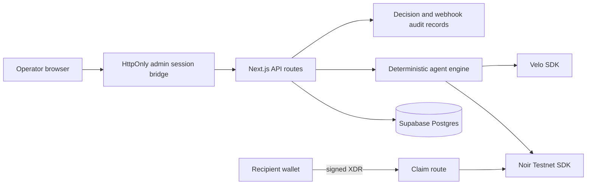

# ABOT architecture

## Boundaries

- Public visitors see clearly labeled, read-only deterministic DEMO MODE.
- Admin actions require a short-lived HttpOnly session validated against the
  existing `ADMIN_API_TOKEN` bearer boundary; the token is not stored in
  localStorage or shipped as a public build value.
- `SUPABASE_SERVICE_ROLE_KEY`, `AGENT_SECRET`, `VELO_API_KEY`, and
  `VELO_WEBHOOK_SECRET` stay server-only.
- Velo operating-balance funding and Noir escrow funding are separate actions.
- Recipient claims use wallet-signed XDR; private keys never cross ABOT.
- Testnet transaction evidence is documented in
  [`docs/testnet-evidence.md`](testnet-evidence.md).
